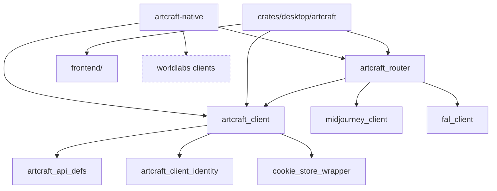

# Code map (our fork)

Upstream's Cargo workspace (`Cargo.toml` members) plus an Nx/TypeScript frontend for the Tauri app. This map is ours: what each part owns, how they connect, and what differs per platform (R04).

## Modules

| Path | Owns | Platform notes |
|---|---|---|
| `artcraft-native/` | The pure-Rust desktop app (egui, no Tauri): `backend` (Tokio, every API call, session, media cache, audio, providers), `models`, `prompt_box`, `pages` (Create Image/Video/Audio, Home, Library), `feed`, `overlays`, `shell`, `theme`/`ui`. See its README's Architecture table | Windows and macOS builds; pure Rust, so Linux should build but is untried |
| `crates/desktop/artcraft` | The Tauri desktop app (default workspace member), with the web frontend in `frontend/` | Windows and macOS only (`tauri.conf.json`, `tauri-mac.conf.json`) |
| `frontend/` | Nx workspace: the Tauri app's TypeScript UI and libs | node; built into the Tauri app |
| `crates/api_clients/artcraft/*` | `artcraft_api_defs`, `artcraft_client` (typed API calls), `artcraft_router` (routes jobs to ArtCraft, Midjourney or fal) | pure, all |
| `crates/api_clients/*` (others) | Clients for fal, GMI Cloud, Grok, Kinovi, Midjourney, OpenAI Sora, World Labs | pure, all |
| `crates/lib/*` | Shared helpers: client identity headers, browser emulation, cookie stores, Cloudflare handling, files and mimetypes, JWT, URL and UUID utils, errors, memory store | pure, all |
| `crates/schema/*` | SQLite task schema, public enums and tokens | all |
| `crates/testing/*` | Test data and helpers | all |
| `crates/vendor/tauri-plugin-http` | Vendored Tauri HTTP plugin | Tauri app only |

## How they connect

The "coming soon" pages in `artcraft-native/src/shell.rs` (`Page::is_ready`) map to web-app paths; each build issue replaces one with a native page using the same client crates.

## Mac, PC and Linux

- CI today: `artcraft-macos-publish.yml` and `artcraft-windows-publish.yml` build release packages; nothing runs the tests on a PR (build issue).
- Platform code: window chrome (caption buttons, drag, resize) in `artcraft-native/src/ui`, the Midjourney sign-in webview, and the Tauri configs.
- Credentials and settings live under `~/Artcraft/` on every OS; the Tauri cookie jar path comes from the OS cache dir.
