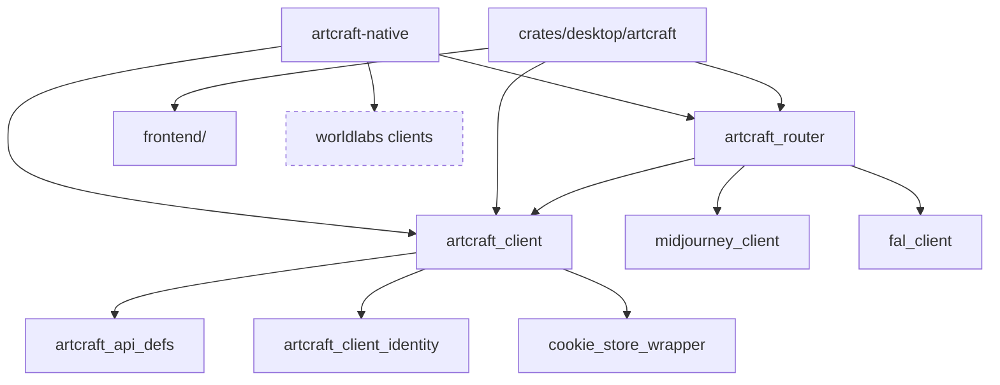

# Code map (our fork)

Upstream's Cargo workspace (`Cargo.toml` members) plus an Nx/TypeScript frontend for the Tauri app. This map is ours: what each part owns, how they connect, and what differs per platform (R04). Audited 2026-10-28 against `main`, which holds all of `upstream/main` (the workspace has 39 members, listed in `Cargo.toml`; the table groups them).

Describes commit: 52e578e (2026-10-28)

## Modules

| Path | Owns | Platform notes |
|---|---|---|
| `artcraft-native/` | The pure-Rust desktop app (egui, no Tauri): `backend` (Tokio, every API call, session, media cache, audio, providers), `models`, `prompt_box`, `pages` (Create Image/Video/Audio, Home, Library), `feed`, `overlays`, `shell`, `theme`/`ui`. See its README's Architecture table | Windows and macOS builds; pure Rust, so Linux should build but is untried |
| `crates/desktop/artcraft` | The Tauri desktop app (the only default workspace member, so a bare `cargo build` builds this, not the native app), with the web frontend in `frontend/` | Windows and macOS only (`tauri.conf.json`, `tauri-mac.conf.json`; `tauri-dev-*.conf.json` for development) |
| `frontend/` | Nx workspace: the Tauri app's TypeScript UI (`apps/artcraft`) and libs (`api`, `omni-gen`, `model-list`, `state`, `tauri-api`, ...) | node; built into the Tauri app |
| `crates/api_clients/artcraft/*` | `artcraft_api_defs`, `artcraft_client` (typed API calls), `artcraft_router` (routes jobs to ArtCraft, Midjourney or fal) | pure, all |
| `crates/api_clients/*` (others) | Clients for fal, GMI Cloud, Grok, Kinovi, Midjourney, OpenAI Sora, World Labs | pure, all |
| `crates/lib/*` | Shared helpers: build metadata, client identity headers, browser emulation, cookie stores, Cloudflare handling, files and mimetypes, JWT, URL and UUID utils, errors, memory store | pure, all |
| `crates/schema/*` | SQLite task schema, public enums and tokens | all |
| `crates/testing/*` | Test data and helpers | all |
| `crates/vendor/tauri-plugin-http` | Vendored Tauri HTTP plugin | Tauri app only |
| `script/`, `_docs/`, `_database/sql/`, `test_data/` | Not in the workspace: build, dev and release scripts (`script/artcraft/` has `unix_*.sh` and `windows_*.ps1`, plus version bump and release-branch push); `dev_setup.md` and the OmniGen API notes; the SQLite task migration; sample media for tests | scripts per OS: shell on macOS, PowerShell on Windows |

## How they connect

Dashed: not wired yet. `artcraft-native` also depends on `artcraft_api_defs`, `fal_client` and `midjourney_client` directly; it does not depend on any `worldlabs` crate today (Create World, #13, would).

The "coming soon" pages in `artcraft-native/src/shell.rs` (`Page::is_ready`) map to web-app paths; each build issue replaces one with a native page using the same client crates. On 2026-10-26 the pages present are Home, Create Image, Create Video, Create Audio and Library (`pages/`); still "coming soon" (placeholder in `pages/other.rs`): Create 3D Object (#12), Create World (#13), Edit Image (#14), 3D Stage (#15), Video Editor (#16); BG Remove and Frame Extract are not filed here because upstream has open PRs (#2577, #2573). Our delta over upstream is documentation only (`PIPELINE.md`, `SPEC.md`, `CHANGELOG.md`, `AGENTS.fork.md`, this map, `docs/agents/`, and ten lines in `AGENTS.md`); every source file is upstream's, and on 2026-10-28 `main` was level with `upstream/main`.

## Mac, PC and Linux

- CI today: `artcraft-macos-publish.yml` and `artcraft-windows-publish.yml` build release packages of the Tauri app (`crates/desktop/artcraft`), on pushes to the `release` and `artcraft-release` branches (plus `artcraft-macos` or `artcraft-windows` for testing); neither builds `artcraft-native`. `sonarcloud.yml` runs on pull requests and pushes to main through a shared workflow in `storytold/craft-common-actions`, and this repo does not show what it runs. Nothing here runs `cargo test` on a PR (#11).
- Platform code: window chrome (caption buttons, drag, resize) in `artcraft-native/src/ui/window.rs`, the Midjourney sign-in webview (`wry`, in `artcraft-native/src/main.rs` and `overlays/providers.rs`), one `#[cfg(windows)]` block in `backend/video.rs`, and the Tauri configs.
- Credentials and settings live under `~/Artcraft/` on every OS; the Tauri cookie jar path comes from the OS cache dir.
